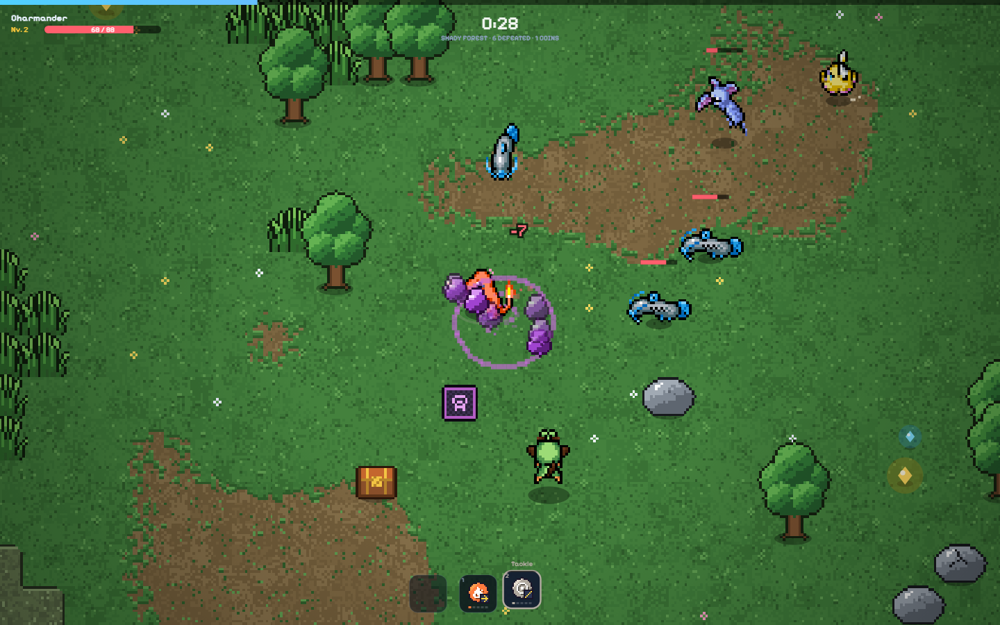
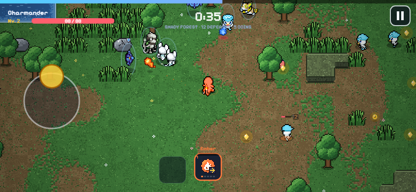

# PokéSurvivor — Play Online at SurvivorPoke

**Choose a Pokémon partner, survive enemy hordes and evolve your moves in a free browser survival game.** PokéSurvivor combines automatic attacks, movement and run-by-run upgrades with a persistent Pokémon collection.

**[▶ Play PokéSurvivor](https://survivorpoke.com/?utm_source=github&utm_medium=referral&utm_campaign=pokesurvivor&utm_content=readme_play)** · [How to play](docs/getting-started.md) · [Player guides](https://survivorpoke.com/guides/)

This repository provides player documentation, screenshots and support for the game hosted at **survivorpoke.com**. You may also see the game written as **PokeSurvivor** or **Poke Survivor**. The game runs on the website; this repository contains no game implementation or deployment files.

## Start playing

1. [Open the game](https://survivorpoke.com/) and press **Press to start**. For a new save, complete the personality quiz.
2. Choose your first Pokémon partner and enter a run.
3. Move around enemy attacks while your selected move attacks automatically.
4. Collect experience and choose one of the three rewards when you level up.
5. Earn tickets, expand your collection and buy permanent upgrades between runs.

You can start without downloading an installer or manually registering an account. The game creates an anonymous player identity when needed. Permanent progress can be saved; a battle itself cannot be resumed after refreshing the page.

## What you can do

| Player goal | How it works | Read more |
| --- | --- | --- |
| Survive longer | Dodge attacks, collect experience and choose useful move/stat rewards. | [Getting started](docs/getting-started.md) |
| Evolve a move | Reach move level 5, obtain its required run-stat card, then select a gold evolution reward. | [Evolution requirements and recipes](docs/move-evolutions.md) |
| Collect Pokémon | Use regional ticket banners, earn rewards and encounter wild Pokémon and shinies. | [Collection and gacha guide](https://survivorpoke.com/guides/collection-and-gacha/) |
| Challenge legendary bosses | Enter a rift when it appears and defeat its boss; Bonds can combine moves within one slot. | [Legendary rifts and Bonds](https://survivorpoke.com/guides/legendary-rifts/) |
| Play on a phone | Use landscape orientation, drag the floating joystick and tap move/reward icons. | [Controls and mobile](docs/controls-and-mobile.md) |
| Keep progress | Check the account/save status and use optional Google linking before changing browser or device. | [Save and recovery help](docs/save-and-sync.md) |
| Join friends | Add friends by nickname, invite them to a room and wait for connection before the host starts. | [Co-op and connection help](docs/multiplayer.md) |
| Compare run results | Finish an eligible run and check this site's Solo or Group leaderboard. | [Leaderboard guide](https://survivorpoke.com/guides/leaderboard/) |

## Controls at a glance

| Action | Desktop | Mobile |
| --- | --- | --- |
| Move | **WASD** or arrow keys | Drag the floating joystick |
| Select an active move | **1–4**, **Q/E**, or click its icon | Tap the move icon |
| Choose a level-up reward | **1–3** or click a card | Tap the card |
| Pause a solo run | **Esc/P** or the pause button | Tap the pause button |

Normally, only the currently selected move attacks automatically. Having four regular move slots does not mean four moves fire together. A **Bond** can combine multiple moves in one slot. In co-op, opening your pause menu does not stop your teammates' game.

[Full controls, fullscreen and performance help →](docs/controls-and-mobile.md)

## Move evolution: two examples

| Base move | Required level | Required card in this run | Evolution |
| --- | --- | --- | --- |
| Ember | 5 | Power | Fire Blast |
| Bubble | 5 | Sprint | Surf |

Once those conditions are met, take the gold evolution card when it is offered. Permanent upgrades are a separate system and do not replace the required run card. This is **move evolution**, not a promise that your partner changes Pokémon species.

[Browse the complete recipe table and troubleshoot missing evolution rewards →](docs/move-evolutions.md)

## Saves, mobile and co-op

**Saves:** collection and permanent progression survive between runs. Keep the browser's player identity, watch for the cloud-sync confirmation, and read the account guidance before clearing site data. Account settings offer optional Google linking. Nicknames alone cannot recover an anonymous identity. Accounts and leaderboard records on survivorpoke.com are separate from the original game's website.

**Mobile:** play in landscape orientation. Drag to move and tap to select moves or rewards. Fullscreen availability depends on the browser; adding the site to your home screen is a browser shortcut rather than an APK download.

**Co-op:** groups can include up to four players. Connection depends on the players' networks and available relay support. If an invitation succeeds but the room does not connect, follow the [multiplayer troubleshooting steps](docs/multiplayer.md) before starting. Universal cross-network connectivity is not promised.

## Player documentation

- [Getting started: your first run, collection, rifts and rankings](docs/getting-started.md)
- [Controls, mobile play and performance](docs/controls-and-mobile.md)
- [Move evolutions: recipes, cards and common mistakes](docs/move-evolutions.md)
- [Saving progress, Google linking and recovery](docs/save-and-sync.md)
- [Multiplayer: friends, rooms and connection problems](docs/multiplayer.md)
- [Troubleshooting: loading, moves, missing saves and scores](docs/troubleshooting.md)

The [on-site guide collection](https://survivorpoke.com/guides/) covers the game running at this address. For additional reference material, the separate [PokéSurvivor Wiki and tools](https://poke-survivor.org/) includes databases and calculators; it is not the game's account or leaderboard service.

## Feedback and documentation contributions

Found a wrong recipe, unclear instruction or reproducible problem? [Open an issue](https://github.com/Poke-Survivor/pokesurvivor/issues/new/choose) with the steps, your browser/device and what happened. Documentation corrections and useful player explanations are welcome: see [CONTRIBUTING.md](CONTRIBUTING.md).

Do not post passwords, recovery credentials, account identifiers or complete save files. Contact: [hello@survivorpoke.com](mailto:hello@survivorpoke.com).

[Repository updates](CHANGELOG.md) · [Game home screenshot](media/home.png) · [Credits](CREDITS.md) · [About this hosted version](https://survivorpoke.com/about/)

## Credits and scope

The hosted game is based on [JPTER78's PokéSurvivor project](https://github.com/JPTER78/pokesurvivor). This player-resource repository is maintained for survivorpoke.com and does not represent the original author or an official Pokémon project.

Upstream code, SpriteCollab artwork and fonts have separate licenses. Screenshots do not grant ownership of Pokémon characters or a blanket license to their artwork. See [CREDITS.md](CREDITS.md) and the [game's artist credits](https://survivorpoke.com/credits).
